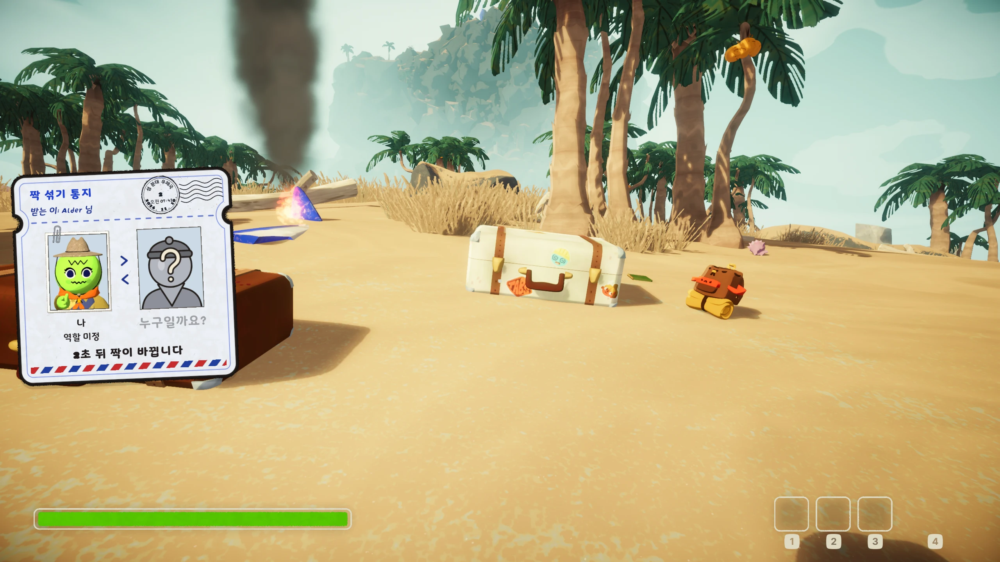
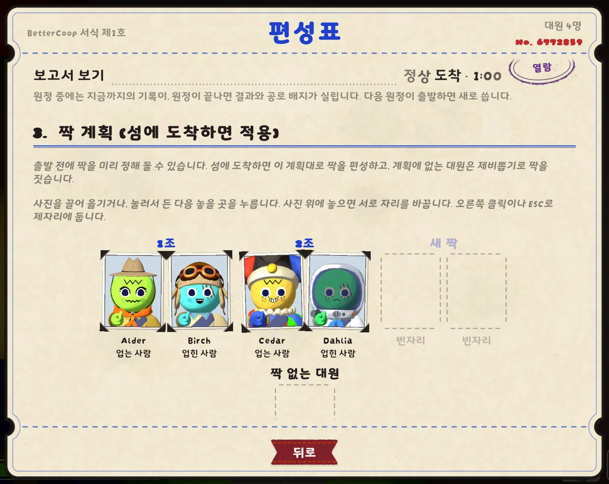
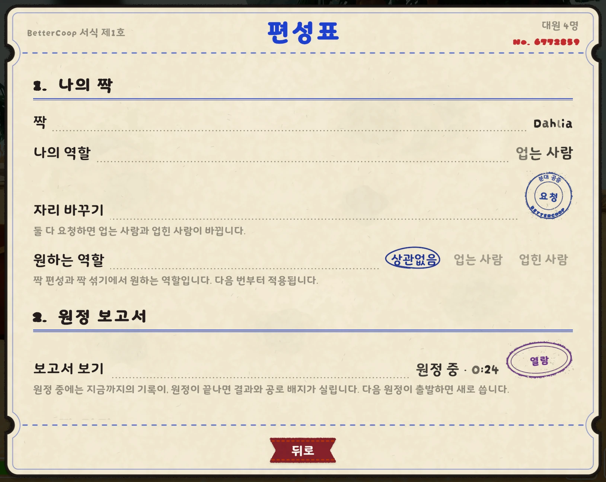
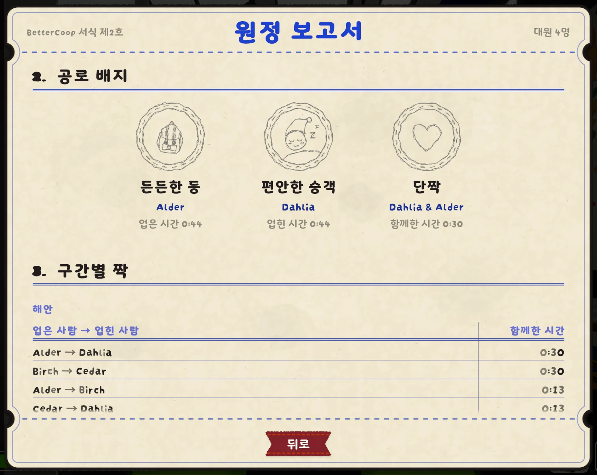
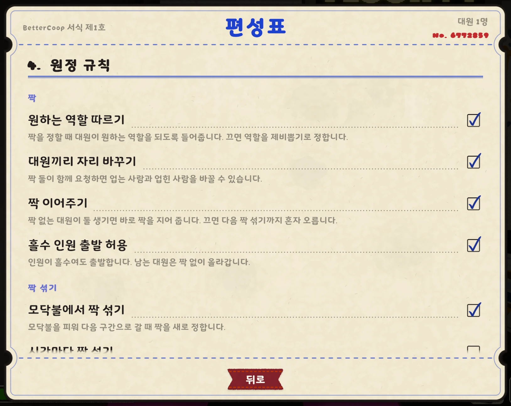

# BetterCoop

[English](README.md)

스카우트는 둘, 몸은 하나. **업는 사람**은 키보드를, **업힌 사람**은 마우스를
잡고, 살아도 죽어도 함께입니다. 길을 잘 아는 짝을 만나길, 버섯만 보면 먹고
보는 짝은 만나지 않길 빕니다.

## 플레이

| 업는 사람 (키보드) | 업힌 사람 (마우스) |
| --- | --- |
| 이동, 점프, 달리기, 웅크리기 | 시점과 방향 |
| 상호작용, 줍기, 내려놓기, 던지기 | 든 아이템 사용 |
| 단축 슬롯, 감정 표현, 가방 휠 열기 | 스크롤, 핑, 가방 휠에서 고르기 |

- ESC 메뉴의 **편성표**에서 누가 누구를 업었는지 볼 수 있고, 원정
  보고서에서는 든든한 등과 편안한 승객에게 공로 배지가 돌아갑니다.
- 모드는 분대장(방을 만든 사람)에게만 있으면 됩니다. 모드가 없는 대원은
  혼자 쓸쓸히 오릅니다.
- 다른 모드와도 잘 어울리지만, 짝으로 있는 동안에는 이 모드의 규칙을
  따릅니다. 같은 일을 하는 Co-op Mod가 있거나 게임 업데이트를 아직 따라가지
  못했다면 잠시 물러납니다.

| 공항의 편성표 | 원정 중의 편성표 | 원정 보고서 |
| --- | --- | --- |
|  |  |  |

## 설정

원정 규칙은 분대장이 편성표에서 정하며, 규칙마다 설명이 붙어 있습니다. 원하는
역할 따르기, 대원끼리 자리 바꾸기, 짝 이어주기, 홀수 인원 출발 허용, 모닥불에서
짝 섞기, 시간마다 짝 섞기, 이어받기(자리, 소지품), 구조 업기, 업힌 사람 무게,
가방은 업힌 사람이 고르기가 있습니다. 원하는 역할은 대원마다 편성표에서
고릅니다. 짝은 잘못한 게 없는데 원정이 자꾸 꼬인다면, 모드 매니저의
설정에서 **Verbose Log**를 켜고 버그를 알릴 때 `BepInEx/LogOutput.log`를 함께
보내 주세요.

## 모드 개발자용

`BetterCoop.Api`로 다른 모드가 BetterCoop 내부에 기대지 않고 짝을 읽을 수
있습니다. `Enabled`, `RoleOf`, `TryGetPartner`, `TryGetSharedBody`(업힌
사람은 업는 사람의 몸으로 플레이합니다)와 `PairsChanged`,
`PairChangeStarting`, `PairChangeFinished` 이벤트가 있습니다. 사용법과
예제는 [영어 README](https://github.com/kawalain/peak-better-coop#for-mod-developers)를
참고하세요.

## 백신 경고

일부 백신이 `BetterCoop.dll`을 `!ml`로 끝나는 이름으로 잡을 수 있습니다.
모드가 흔히 받는 머신러닝의 오진입니다. 파일을 허용하고 모드를 다시
설치하세요. 소스는 <https://github.com/kawalain/peak-better-coop>에 공개되어
있습니다.

## 만든 사람들

- [Sappheiros009](https://github.com/Sappheiros009/CoopMod): BetterCoop이
  시작된 Co-op Mod의 원래 아이디어.
- [Puro](https://steamcommunity.com/profiles/76561198105109754): 아이디어 제공, 테스터.
- [kawalain](https://steamcommunity.com/profiles/76561198436496102): 관리자.

## 라이선스

[MIT](https://github.com/kawalain/peak-better-coop/blob/main/LICENSE)
