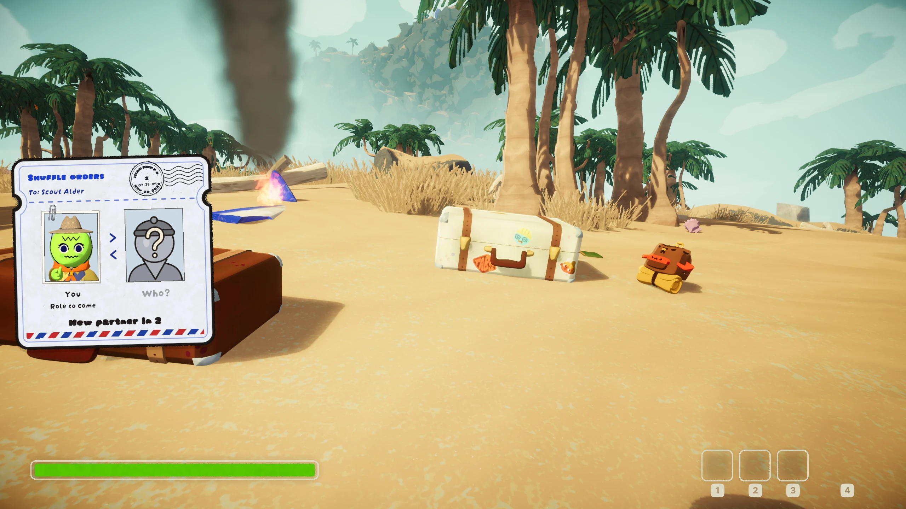
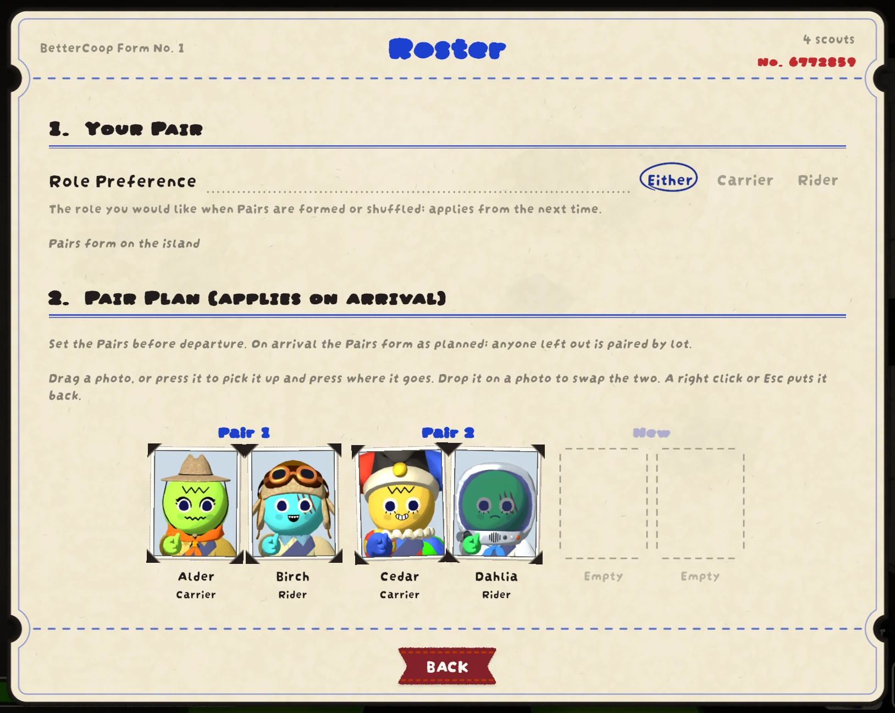
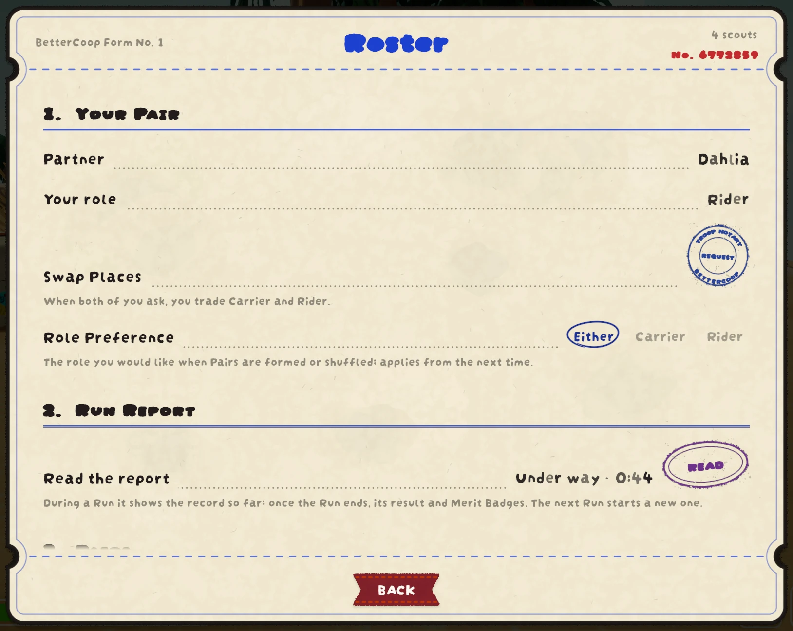
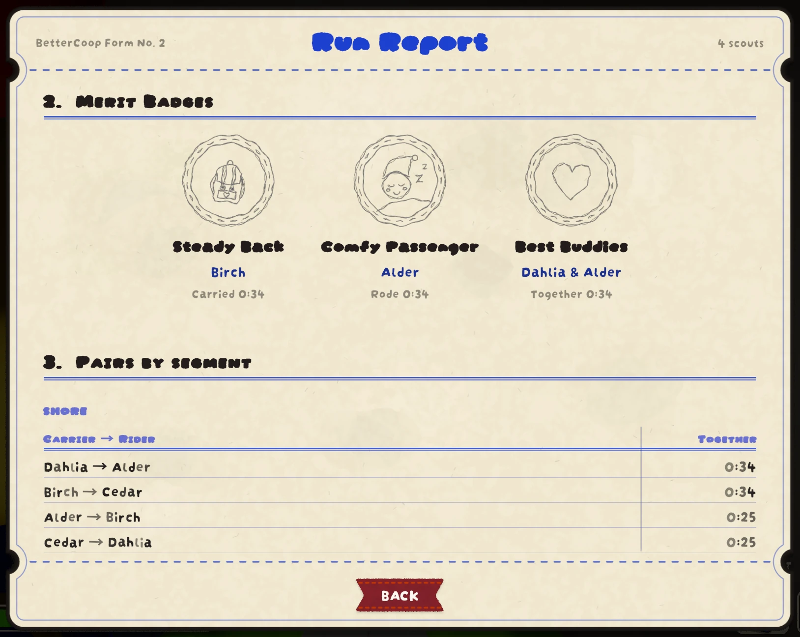
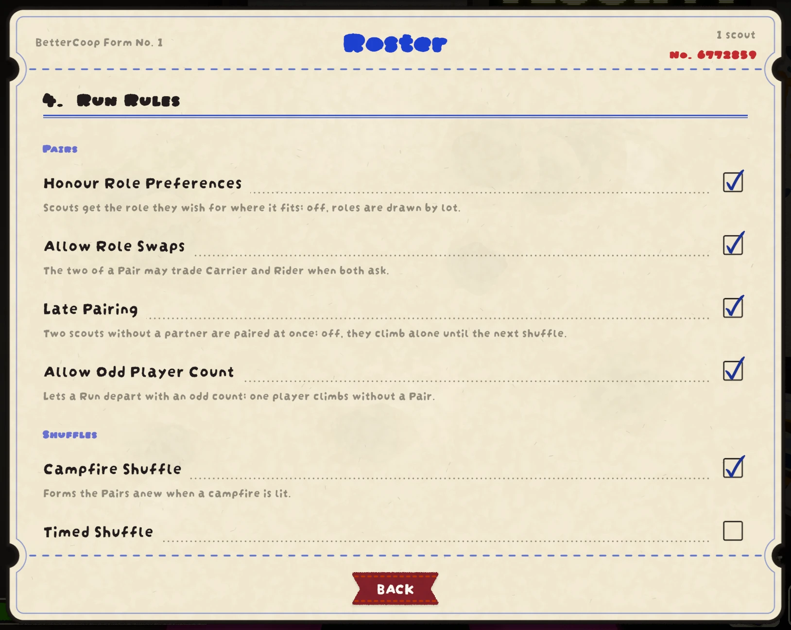

# BetterCoop

Climb PEAK in Pairs. One player carries the other for the whole Run, and the
two steer that one body together: the **Carrier** on the keyboard, the
**Rider** on the mouse. They share stamina and statuses, and they live, die,
and come back together.

[한국어](https://github.com/kawalain/peak-better-coop/blob/main/README.ko.md)



## How it plays

| Carrier (keyboard) | Rider (mouse) |
| --- | --- |
| Move, jump, sprint, crouch | Look and steer |
| Interact, pick up, drop, throw | Use the held item |
| Hotbar, emotes, open the backpack wheel | Scroll, ping, pick from the backpack wheel |

- The **Roster** in the ESC menu shows the Pairs, your role, and the Run
  Report with its Merit Badges.
- Only the Troop Leader (host) needs the mod; players without it climb along
  without a Pair.
- BetterCoop works beside other mods, and while you are in a Pair its rules
  win. It turns itself off beside Co-op Mod, or after a game update it does
  not fit yet.

| Roster at the Airport | Roster during a Run | Run Report |
| --- | --- | --- |
|  |  |  |

## Settings

The Troop Leader sets the Run Rules on the Roster, where each one is
explained: Honour Role Preferences, Allow Role Swaps, Late Pairing, Allow Odd
Player Count, Campfire Shuffle, Timed Shuffle, Hand Over Place and Items,
Rescue Carry, Carry Weight, and Rider Picks From Backpack. Each player sets
their own Role Preference there. When reporting a bug, turn on **Verbose Log**
in your mod manager's config and send `BepInEx/LogOutput.log`.



## For mod developers

`BetterCoop.Api` lets another mod read the Pairs without depending on
BetterCoop's internals: `Enabled` (false while the mod is off, or sits out a
room whose Troop Leader's version does not work with this one), `RoleOf(character)`,
`TryGetPartner(character, out partner)`, `TryGetSharedBody(character, out body)`
(a Rider plays through their Carrier's body), and the events `PairsChanged`,
`PairChangeStarting`, and `PairChangeFinished`. `ApiVersion` rises only when a
change breaks callers. A Rider's own character is idle while carried and its
statuses are kept clear, so a mod that shows players' status should show the
Shared Body instead.

Reference `BetterCoop.dll` as a soft dependency and keep the calls in a
method of their own, so your mod still loads without BetterCoop:

```csharp
[BepInDependency("in.kawala.bettercoop", BepInDependency.DependencyFlags.SoftDependency)]
public class MyPlugin : BaseUnityPlugin
{
    static bool HasBetterCoop => Chainloader.PluginInfos.ContainsKey("in.kawala.bettercoop");

    static bool IsRider(Character character) => HasBetterCoop && IsRiderInBetterCoop(character);

    [MethodImpl(MethodImplOptions.NoInlining)]
    static bool IsRiderInBetterCoop(Character character) =>
        BetterCoop.Api.RoleOf(character) == BetterCoop.Api.Role.Rider;
}
```

## Antivirus warnings

Some antivirus programs flag `BetterCoop.dll` by a machine-learning guess, a
name ending in `!ml`, as they often do with mods. Allow the file and install
the mod again. The source is open at
<https://github.com/kawalain/peak-better-coop>.

## Credits

- [Sappheiros009](https://github.com/Sappheiros009/CoopMod): Co-op Mod, the
  original idea that BetterCoop grew from.
- [Puro](https://steamcommunity.com/profiles/76561198105109754): ideas and
  testing.
- [kawalain](https://steamcommunity.com/profiles/76561198436496102):
  maintainer.

## License

[MIT](https://github.com/kawalain/peak-better-coop/blob/main/LICENSE)
